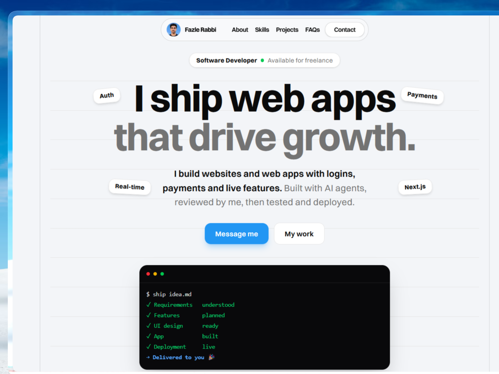

<div align="center">

# 🌍 Fazle Rabbi - Developer Portfolio

A minimal, fast personal portfolio built with Next.js. Clean aesthetic, carefully crafted UI.

[](https://fazle-rabbi-dev.vercel.app/)
[](https://nextjs.org/)
[](https://react.dev/)
[](https://www.typescriptlang.org/)
[](https://tailwindcss.com/)
[](https://bun.sh/)



</div>

## Links

- **Live:** https://fazle-rabbi-dev.vercel.app/
- **Previous Portfolio:** https://fazle-rabbi-dev-2024.vercel.app/

## Sections

Home, About, Skills, Projects, Contact - plus Education and Tech Journey pages.

## Tech Stack

Next.js 16 (App Router) - React 19 - TypeScript - TailwindCSS 4 + ShadCN - Motion - Zustand - Bun

## Getting Started

```bash
bun install
bun dev
```
